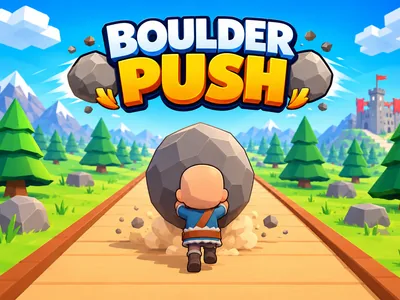
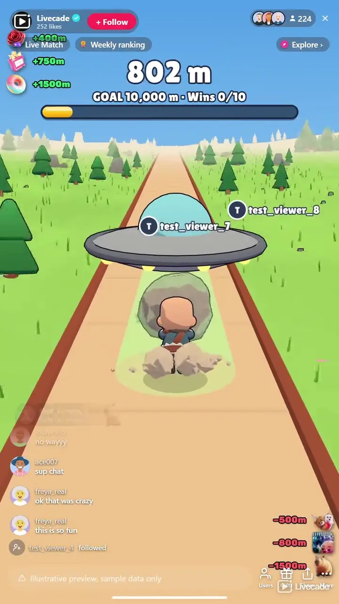

# Boulder Push - Interactive TikTok Live Game

> You push a boulder up a mountain, your chat decides whether it gets there.

You push a boulder up a mountain live while your chat decides how far it gets. Heroes like a Dragon and a Steam Train carry it up, villains like a T-Rex and a UFO knock it back down, and every climb you finish builds a giant statue.

**[Play Boulder Push on Livecade](https://livecade.io/games/boulder-push/?utm_source=github&utm_medium=readme&utm_campaign=boulder-push)** - runs as a single browser source in OBS, Streamlabs, or TikTok LIVE Studio. Nothing for viewers to install.

## How viewers play

Viewers take part with the actions TikTok already gives them: **comments**, **gifts**, **likes**, **follows**, **shares**. Every action below is rebindable, so you decide which interaction drives which effect.

| Action | What it does |
| --- | --- |
| **Capybara** | Carries the boulder 50 metres up on its back. 20 likes by default |
| **Spring Glove** | A glove on a pogo stick bounces behind the rock punching it 100 metres up. A Rose by default |
| **Kangaroo** | Gives him a piggyback and drop-kicks the rock 200 metres up. A Finger Heart by default |
| **Horse** | Hauls the boulder 400 metres up on two ropes. A Rosa by default |
| **Elephant** | Shoves it 750 metres up with its head. A Perfume by default |
| **Steam Train** | Lays its own rails and shunts the boulder 1,500 metres up. A Doughnut by default |
| **Dragon** | Flies the boulder and him 3,000 metres up the road. A Cap by default |
| **Snowball** | A giant snowball smashes into the rock, 100 metres back. A follow by default |
| **Tow Truck** | Hooks the rock on a chain and drags it 150 metres down. A GG by default |
| **Rubber Band** | Catches the rock, stretches and snaps it 300 metres back. A Heart Me by default |
| **Bull** | Charges down the road and rams it 500 metres back. A Friendship Necklace by default |
| **Hippo** | Belly-flops onto the rock and shoves it 800 metres back. A Let 'Em Cook by default |
| **UFO** | Beams the rock up with him clinging on and drops it 1,500 metres down. A Capybara gift by default |
| **T-Rex** | Bites the rock, shakes it and flings it 3,000 metres back. A Hat and Mustache by default |
| **+Win** | A Beaver carries a stone up to the statue, carved with the sender's name. A Money Gun by default |
| **-Win** | A Raccoon runs off with the top stone of the statue. A Galaxy by default |

## How it works

### You push it, live

Hold W or Space to push and A or D to step aside, straight from the dashboard. The pusher runs in your own browser, so it answers instantly, and the stream shows the same moves a moment later. Or set him to Auto and he pushes and dodges on his own.

### Barrels all the way up

Barrels roll down at the boulder alone, in pairs that wall off half the road, or in waves of three. A hit throws the boulder back and stuns him for a moment, so the climb is a game even before the first gift.

### Heroes up, villains down

Fourteen characters, each with its own animation, sound and metres, from a 50 metre Capybara to a 3,000 metre Dragon or T-Rex, and each bindable to any trigger. The big ones shake the screen with every step and every hit.

### Five worlds on the way up

Meadow, forest, rocks, snow and the summit, under a sky that runs from sunrise to sunset as you climb, so how far you got reads at a glance.

## About the game

Boulder Push puts a chibi strongman behind a huge boulder at the foot of a 10,000 metre road and your viewers on both sides of the climb. You push it yourself, holding W or Space and stepping aside with A and D, or let him push on his own. Barrels roll down the road the whole way, alone, in pairs or in waves, so the climb has something to dodge even when chat is quiet, and every trigger in chat is a hero that pushes the boulder up or a villain that shoves it back down.

### Seven heroes, seven villains

Heroes push it up: a Capybara squeezes under the rock and carries it on its back, a pogo stick glove bounces behind it punching on every hop, a Kangaroo gives him a piggyback and drop-kicks the rock, a Horse hauls it on ropes, an Elephant shoves it with its head, a Steam Train lays its own rails and shunts it, and a Dragon flies the rock and him up the road. Villains send it down: a giant Snowball smashes into it, a Tow Truck drags it back on a chain, a Rubber Band catches it and snaps it back, a Bull rams it, a Hippo belly-flops onto it, a UFO beams it up and drops it down the road, and a T-Rex bites the rock, shakes it like a toy and flings it. Every sender's name and photo ride along with their character, and a busy chat piles them on at once.

### Hold the top

Reaching the summit starts a hold countdown. A villain that knocks the boulder off stops it, and it has to be pushed back up. Hold it and the climb counts as a win, and he rides a water slide all the way back down to start the next one.

### A statue built by your chat

Every win adds a stone slice to a giant statue of the pusher at the summit, carved with the name of whoever sent the win. A +Win sends a Beaver running up the road with the next stone on its head, and a -Win sends a Raccoon off down the road with one. When your wins reach the goal the finished statue gets a fireworks show and movie-style end credits naming everyone who built it, then a New Game button starts it over.

## What it looks like on stream

[Watch Boulder Push gameplay](https://cdn.livecade.io/games/boulder-push.mp4)

## What you can configure

- **Language** - Thirteen languages for everything on screen
- **Pusher** - Push it yourself with the keyboard, or let him push and dodge on his own
- **Road to the top** - 2,500, 5,000, 10,000 or 20,000 metres, so a short live gets a short climb. 10,000 metres takes about 40 minutes with no gifts
- **Hold time at the top** - Three to thirty seconds the boulder has to stay on the summit to count
- **Win goal** - The wins that finish the statue and end the game, or 0 to play without one

## Languages

English, Spanish, Portuguese, French, German, Italian, Indonesian, Arabic, Turkish, Russian, Hindi, Romanian, Filipino

## FAQ

<strong>How do viewers play Boulder Push?</strong>

They send heroes and villains. Out of the box 20 likes bring the Capybara, a follow rolls the Snowball, and gifts cover the rest, from a Rose for the Spring Glove up to a Cap for the Dragon and a Hat and Mustache for the T-Rex. A Money Gun adds a win and a Galaxy takes one. Every action can be rebound to comments, likes, follows, shares or any gift, each with its own metres.

<strong>Do I have to push it myself?</strong>

No. Set the pusher to Auto and he pushes and dodges the barrels on his own, which keeps the stream moving while you talk to chat. Switch back to manual at any time.

<strong>Can villains stop me from winning?</strong>

Yes. Reaching the summit only starts the hold countdown. A villain that knocks the boulder off stops it, and the boulder has to be pushed back up and held through the whole countdown again.

<strong>What is the statue?</strong>

Every win adds a stone slice to a giant statue at the summit, carved with the sender's name. A -Win takes the top slice off. When your wins reach the goal, the statue is finished with fireworks and end credits naming everyone who built it.

<strong>Will Boulder Push run on my PC?</strong>

It renders in 3D on the computer running your stream, so give it a reasonably modern machine. Try it in the dashboard preview before you go live.

<strong>How do I add Boulder Push to my TikTok Live?</strong>

Add one browser source URL to OBS or TikTok LIVE Studio and go live. The game is a 9:16 vertical overlay, and there is no plugin or app to install.

## Setup

1. [Create a Livecade account](https://app.livecade.io/register?utm_source=github&utm_medium=cta&utm_campaign=boulder-push)
2. Copy your overlay browser source URL
3. Paste it into OBS, Streamlabs, or TikTok LIVE Studio
4. Pick Boulder Push, set your triggers, and go live

Runs in the browser, so it works on Windows and macOS with nothing to download. [See all TikTok Live games](https://livecade.io/tiktok-live-games/?utm_source=github&utm_medium=readme&utm_campaign=boulder-push).

---

_This repository documents Boulder Push, a hosted interactive game by [Livecade](https://livecade.io/?utm_source=github&utm_medium=footer&utm_campaign=boulder-push). The game runs on Livecade's platform, so there is no source to install here._
